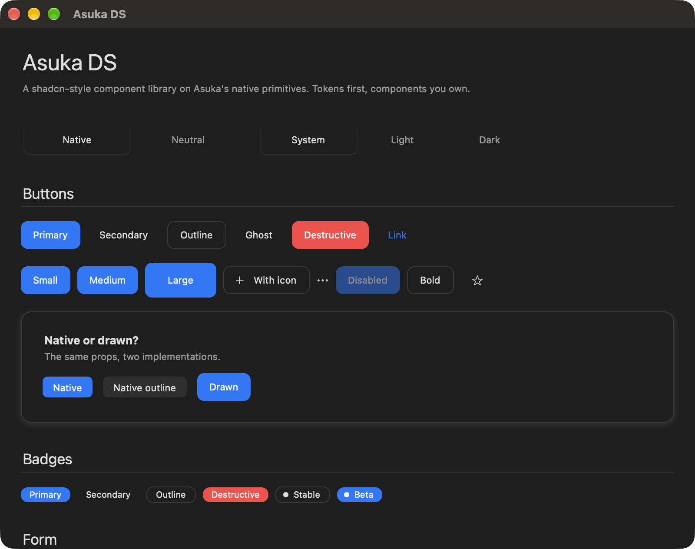
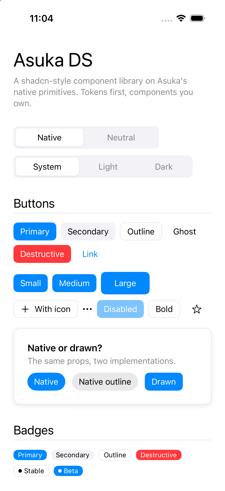
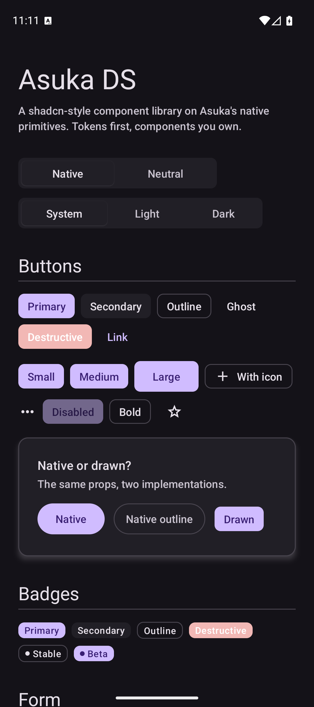

# Asuka DS

> 跑在 [Asuka](https://asuka.egoist.dev) 上的、源码可拥有的组件库。

`Go 1.26+` · `Asuka 0.1.1` · `43 个组件` · `76 个测试` · `MIT`

Asuka DS 把 shadcn/ui 的 token 结构与组合方式带到 Go：同一套强类型主题、
可复制的组件源码，以及 Asuka 的原生控件和细粒度更新。它不是一个锁定你的
运行时——CLI 把组件源码复制进你的仓库，代码从此归你所有。

## 为什么是它

- **原生优先**：按钮、输入框、选择器、弹层在关键路径上使用平台自己的控件，
  输入法、选区、焦点、键盘和读屏行为都由平台负责。
- **源码可拥有**：`asuka-ds add` 只复制普通 Go 文件，没有生成的运行时、
  没有隐藏的依赖注入。改代码、改 API、整体 vendor 都可以。
- **token 是结构体**：`Palette`、`Radii`、`TypeScale`、`Motion` 都是强类型，
  能做 WCAG 对比度计算，不散落十六进制。
- **主题是 signal**：`SetTheme` / `SetAppearance` 实时换肤，不重建页面。
- **一个 API，两种质感**：自绘组件保证品牌一致，原生组件保证平台手感。

## Native 与 Neutral 的区别

两个主题共用同一套组件 API，差别只在颜色的来源和平台差异的取舍：

| | `ds.Native()` | `ds.Neutral()` |
|---|---|---|
| 颜色来源 | 平台语义色（`colors.*`） | shadcn zinc 明/暗两套十六进制 |
| 深色模式 | 跟随系统，也跟随系统对比度 | 跟随 `SetAppearance` 的显式 Light/Dark |
| 平台差异 | 保留：iOS 蓝、Material 动态色、Windows accent | 抹平：六个平台同一张脸 |
| 无障碍 | 由平台语义色保证 | 由 `Theme.Validate` 做 WCAG 2.1 AA 校验 |
| 适合 | 系统集成、原生质感、跟随用户设置 | 品牌一致性、跨端截图、营销页面 |

```go
ds.SetTheme(ds.Native())   // 像系统应用
ds.SetTheme(ds.Neutral())  // 像 shadcn
ds.SetAppearance(ui.ColorSchemeDark)
```

`Native` 在 `System` 下使用平台语义色；强制 Light/Dark 时改用内置近似色，
保证换肤不依赖宿主回环（macOS 要等窗口重绘才回报新的 appearance）。

## 快速开始

### 1. 安装 CLI

```sh
go install github.com/egoist/asuka-ds/cmd/asuka-ds@latest
```

### 2. 初始化一个包

```sh
asuka-ds init --dir internal/ds --package ds
```

`init` 写入基础层：主题、文本、`Pressable`、`Field` 和共享的 variant 词汇，
不包含任何具体组件。

### 3. 按需添加组件

```sh
asuka-ds add button input card list
asuka-ds add date-range-picker --dir internal/ds
asuka-ds list
```

依赖会自动解析：`add switch` 会一并安装 `overlay.go`，`add command` 会安装
`button.go`。已存在的文件默认不覆盖，只有显式 `--force` 才会覆盖。

### 4. 使用

```go
package main

import (
	ds "example.com/app/internal/ds"

	"github.com/egoist/asuka/app"
	"github.com/egoist/asuka/signal"
	"github.com/egoist/asuka/ui"
)

func App() ui.Node {
	email := signal.New("")

	return ds.Screen(
		ds.Heading("Settings"),
		ds.Card(ds.CardProps{},
			ui.Column(ui.Style{Gap: ds.Space4},
				ds.CardHeader("Profile", "How the team sees you."),
				ds.Input(ds.InputProps{
					Value: email, Label: "Email", Placeholder: "ada@example.com",
					Icon: ui.IconMail, Description: "We never share it.",
				}),
				ds.CardFooter(
					ds.Button(ds.ButtonProps{Text: "Cancel", Variant: ds.Ghost, OnPress: func() {}}),
					ds.Button(ds.ButtonProps{Text: "Save", Variant: ds.Primary, OnPress: func() {}}),
				),
			),
		),
	)
}

func main() { app.Run(App) }
```

## 三种使用方式

| 方式 | 命令 | 适合 |
|---|---|---|
| CLI 复制源码 | `asuka-ds add button` | 想完全拥有、修改组件源码的团队 |
| 模块依赖 | `go get github.com/egoist/asuka-ds/ds` | 想跟随上游升级、不 vendor 的项目 |
| 直接复制仓库 | `git clone` + copy | 一次性评估或做设计参考 |

CLI 的组件源码内嵌在二进制里，所以 `add` 不需要网络，也不需要 checkout 本仓库。

## 组件目录（43）

| 类别 | 组件 |
|---|---|
| Button (1) | `Button` / `NativeButton`：6 变体 × 4 尺寸 |
| Form (16) | `Input`、`Textarea`、`NumberField`、`DatePicker`、`DateRangePicker`、`Switch`、`Checkbox`、`RadioGroup`、`Select`、`Combobox`、`SegmentedControl`、`Slider`、`Toggle`、`ToggleGroup`、`Command`、`ColorPicker` |
| Navigation (4) | `Tabs`、`Accordion`、`Breadcrumb`、`Pagination` |
| Overlay (5) | `Dialog`、`ConfirmDialog`、`Menu`、`Popover`、`Toast` |
| Data display (8) | `Card` 系列、`Badge`、`Avatar`、`Table`、`DataTable`、`List` / `ListItem`、`Stat`、`EmptyState` |
| Feedback (6) | `Alert`、`Progress`、`ProgressRing`、`Spinner`、`Skeleton`、`Tooltip` |
| Typography (3) | `Heading`、`Text` / `Muted` / `Title`、`Kbd` |

`Pressable` 是所有自绘交互的统一入口：disabled、selected、expanded 通过动态
`Hint` 与事件门控表达；原生控件则直接使用平台自己的 disabled/checked 语义。

## 主题与 token

```go
theme := ds.Neutral()
if problems := theme.Validate(); len(problems) > 0 {
	log.Fatal(problems) // 缺少角色，或对比度低于 WCAG AA
}

ds.SetTheme(theme)
ds.SetAppearance(ui.ColorSchemeSystem)
```

自绘组件通过 `ds.Themed` 读取主题，用户写的样式也参与实时换肤：

```go
ds.Themed(func(t ds.Theme, c ds.Palette) ui.Style {
	return ui.Style{Background: c.Elevation2.Overlay, CornerRadius: t.Radii.LG}
})
```

## 质量

```sh
gofmt -l .
go vet ./...
go test -count=1 ./...
asuka vet ./...
asuka build --platform web website
```

- 76 个测试覆盖组件行为、无障碍、主题 token、目录完整性和 CLI（每个组件的安装路径都有子测试）；
- `Theme.Validate` 检查每个色板的角色完整性与 WCAG 2.1 AA 对比度；
- 内嵌 registry 有 drift 测试：仓库组件与 CLI 分发的源码必须逐字节一致；
- CI 同时跑 Go 测试、`asuka vet` 和文档站的 Web 构建。

## 文档站与演示

文档站本身用 Asuka DS 构建，包含指南、token 参考、43 个组件的实时预览和
响应式原生菜单：

```sh
asuka dev --platform web website
asuka build --platform web website   # 输出 website/dist/web
```

推送到 `main` 后，`.github/workflows/pages.yml` 会把文档站发布到 GitHub Pages；
在仓库 Settings → Pages 里把 Source 选成 “GitHub Actions” 即可，地址是
`https://<owner>.github.io/<repo>/`。构建用 `--base` 指向仓库名，项目页子路径下
的 wasm、manifest 和 service worker 都能正常加载；绑定自定义域名（站点在根路径）
时，去掉该命令的 `--base` 即可。

两个演示应用：

```sh
asuka dev examples/showcase          # 桌面（macOS 上是 AppKit 窗口）
asuka dev --platform web examples/form
```

| macOS（Native 深色） | iOS（Native 浅色） | Android（Native 深色） | Web（Neutral 深色） |
|---|---|---|---|
|  |  |  |  |

平台支持矩阵、验证方式和已知差异见 [docs/platforms.md](docs/platforms.md)；
更多截图见 [artwork/screenshots](artwork/screenshots)。

## 项目结构

```text
ds/                     组件与 token（package ds）
cmd/asuka-ds/           CLI：init / add / list / version
internal/catalog/       组件目录与 kit 依赖（唯一事实来源）
internal/registry/      CLI 内嵌的源码快照与 drift 测试
website/                文档站
examples/               演示应用（showcase / form）
docs/                   平台矩阵与调研记录
DESIGN.md               设计说明
rfcs/                   里程碑实施计划
artwork/screenshots/    截图
```

新增组件时：写 `ds/*.go` → 在 `internal/catalog/components.json` 登记 kit 和
组件 → `go run ./internal/registry/gen` 同步内嵌源码 → 在 `website/examples.go`
加预览 → 跑测试。

## 路线图

| 阶段 | 状态 | 交付 |
|---|---|---|
| M0–M3 | ✅ | token、双主题、原语、43 个组件、两个 demo |
| M4 | ✅ | registry、CLI、文档站、模块身份 |
| M5 | 进行中 | 发布流水线 ✅；macOS/Web/iOS/Android 已验证；Windows/Linux 待真机 |

## 发布

```sh
git tag v0.1.0
git push origin v0.1.0
```

标签触发 [release.yml](.github/workflows/release.yml)：GoReleaser 用
`-X main.Version` 写入版本，构建 macOS、Linux、Windows 的 amd64/arm64
二进制和校验文件，并创建 GitHub Release。CI 还会对同一份代码做
Windows/Linux 交叉编译。

## 已知边界

- Asuka 的原生控件不能深度换肤；DS 负责外壳、标签和 token。
- iOS 上容器的 `Color` 就是 tint，语义 accent 背景会按 tint 解析；自绘组件
  只给文字和图标上色，不给带 accent 背景的容器上色（已有回归测试）。
- 自绘控件没有原生 `Disabled` / selected / expanded trait，当前用 `Pressable`
  的 `Hint` 与事件门控兜底；关键路径仍建议用 `NativeButton` 等原生控件。
- 组件 props 在 1.0 前属于预发布 API：新增走 minor，破坏性变更附迁移说明。

细节与上游建议见 [docs/research.md](docs/research.md)，设计说明见
[DESIGN.md](DESIGN.md)。

## 贡献

```sh
go test ./...                    # 组件、主题、CLI、website
go run ./internal/registry/gen   # 改了组件源码后同步 registry
gofmt -l .                       # 应无输出
```

提交前请保持 `go vet ./...` 与 `asuka vet ./...` 通过，并在 PR 里说明组件行为
或 token 的变化。

## License

[MIT](LICENSE)
