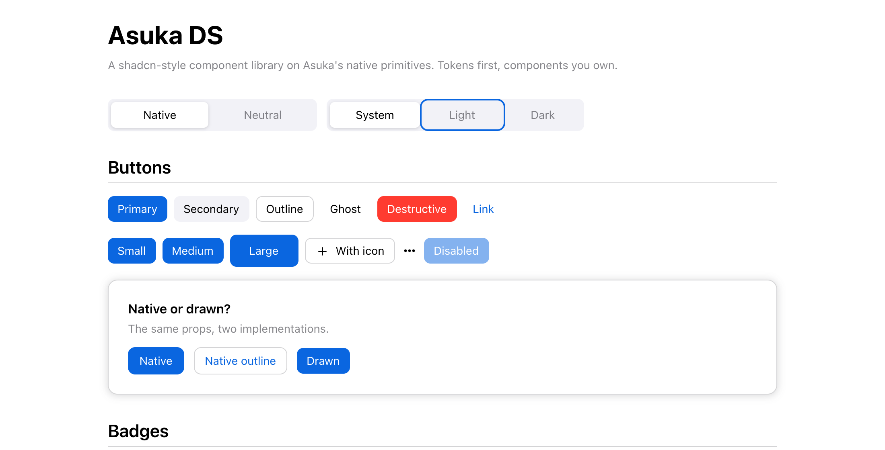
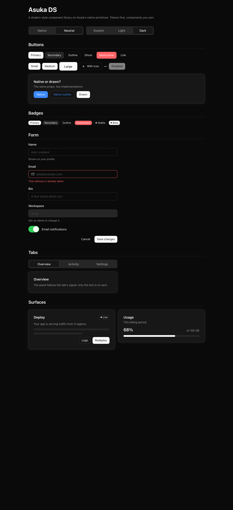
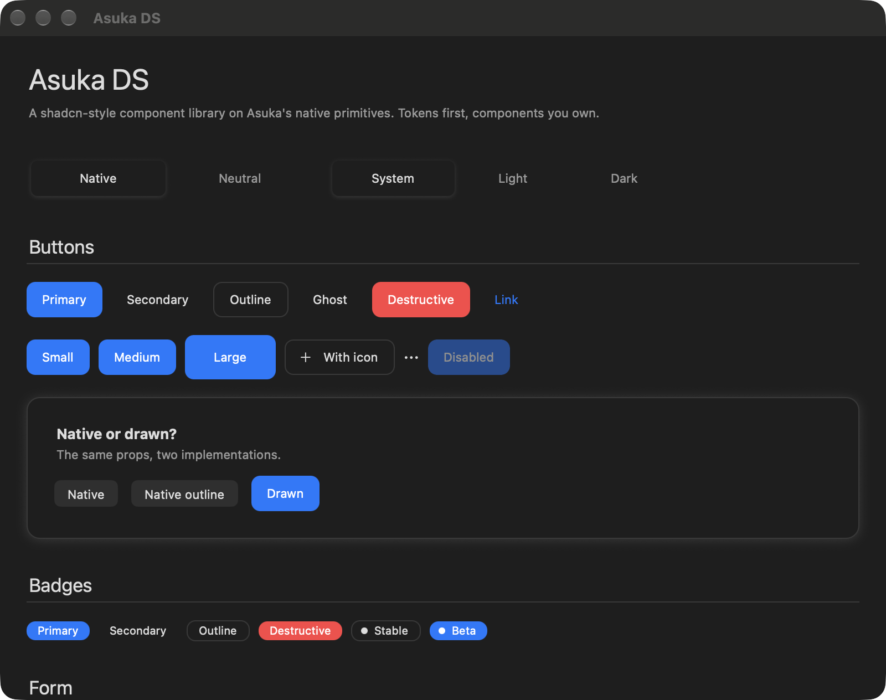

# Asuka DS

一个跑在 [Asuka](https://asuka.egoist.dev) 上的 Design System 原型：shadcn/ui 的 token 结构与组件形态，加上 Asuka 的原生控件与细粒度更新。

> 调研结论、可行性边界、路线图见 [docs/research.md](docs/research.md)。

## 它长什么样

同一份 Go 代码，三种外观：

| Native 主题（Web） | Neutral 主题（Web） | macOS 原生 |
|---|---|---|
|  |  |  |

## 快速开始

```sh
go install github.com/egoist/asuka/cmd/asuka@latest

asuka dev demo                  # 本机运行（macOS 上是 AppKit 窗口）
asuka dev --platform web demo   # 浏览器
asuka build --platform web demo # 静态站点
asuka vet ./...
```

## 用法

```go
package main

import (
	ds "asuka-ds"

	"github.com/egoist/asuka/app"
	"github.com/egoist/asuka/signal"
	"github.com/egoist/asuka/ui"
)

func App() ui.Node {
	email := signal.New("")

	return ds.Screen(
		ds.Heading("Settings"),
		ds.Card(ds.CardProps{},
			ui.Column(ui.Style{Gap: ds.Space4},
				ds.CardHeader("Profile", "How the team sees you."),
				ds.Input(ds.InputProps{
					Value: email, Label: "Email", Placeholder: "ada@example.com",
					Icon: ui.IconMail, Description: "We never share it.",
				}),
				ds.CardFooter(
					ds.Button(ds.ButtonProps{Text: "Cancel", Variant: ds.Ghost, OnPress: func() {}}),
					ds.Button(ds.ButtonProps{Text: "Save", Variant: ds.Primary, OnPress: func() {}}),
				),
			),
		),
	)
}

func main() { app.Run(App) }
```

## 设计原则

- **零值可用**：`ds.Button(ds.ButtonProps{Text: "Save"})` 就是主按钮中号。
- **两种皮肤，一套 API**：`ds.Button` 自绘（品牌一致），`ds.NativeButton` 用平台按钮（手感/无障碍最佳）。`ds.Input` 永远是「原生输入框 + DS 外壳」。
- **token 是结构体**：`Palette` / `Radii` / `TypeScale` 都是强类型，能做对比度计算，不散落十六进制。
- **主题是 signal**：`ds.SetTheme(ds.Neutral())` 实时换肤，不重建页面。
- **逃生口**：`ds.Themed(func(t ds.Theme, c ds.Palette) ui.Style { ... })`，用户写的样式也参与换肤。

## 内置主题

| 主题 | 颜色来源 | 适合 |
|---|---|---|
| `ds.Native()` | 平台语义色（`colors.*`） | 跟随系统深色/对比度/Android 动态色，最像原生应用 |
| `ds.Neutral()` | shadcn zinc 明/暗两套 | 六个平台同一张脸，品牌优先 |

```go
ds.SetTheme(ds.Neutral())
ds.SetAppearance(ui.ColorSchemeDark)
```

`SetAppearance` 同时设置宿主的外观和 DS 内部的外观信号：自绘组件在点击时立即换用对应明暗调色板，不必等宿主把新的 `Dark` 环境回传（macOS 上这一步要等窗口自己的重绘）。`Native` 在 `System` 下仍使用平台语义色；强制 Light/Dark 时改用内置的明暗近似色，保证换肤不依赖宿主回环。

## 里程碑

| 阶段 | 状态 | 交付 |
|---|---|---|
| M0 原型 | ✅ | token、双主题、基础组件、Web/macOS 演示 |
| M1 基础设施 | ✅ | `Theme`/`Palette`/`Radii`/`TypeScale`/`Motion`/`Elevation`、WCAG 校验、实时换肤 |
| M2 原语与无障碍 | ✅ | `Pressable`、`Field`、`Overlay`、`Menu`、动态状态语义、29 个 `uitest` |
| M3 组件扩充 | ✅ | 表单、导航、数据展示、反馈、命令面板与两个 demo |
| M4 分发与文档 | 待办 | registry + `asuka-ds add`、正式文档站 |
| M5 质量 | 待办 | 六平台截图快照、CI、真机走查 |

设计边界与方案见 [设计说明](docs/superpowers/specs/2026-11-14-asuka-ds-design.md)，里程碑验收计划见 [实施计划](docs/superpowers/plans/2026-11-14-asuka-ds-m1-m3.md)。

## 组件

| 类别 | 组件 |
|---|---|
| Surface | `Card` 系列、`Badge`、`Separator`、`Skeleton`、`Alert`、`Avatar`、`Progress`、`Spinner`、`Table`、`EmptyState` |
| Form | `Input`、`Textarea`、`DatePicker`、`Field`、`Switch`/Checkbox、`RadioGroup`、`Select`、`Slider`、`Command` |
| Navigation | `Tabs`、`Accordion`、`Breadcrumb`、`Pagination` |
| Overlay | `Dialog`、`ConfirmDialog`、`Overlay`、`Menu`、`Toast`、`Tooltip` |
| Typography | `Heading`、`Title`、`Text`、`Muted`、`Kbd`、`Screen` |
| Button | `Button` / `NativeButton`：6 变体 × 4 尺寸 |

`Pressable` 是所有自绘交互的统一入口：disabled、selected、expanded 通过动态 `Hint` 与事件门控表达；原生控件则直接使用平台自己的 disabled/checked 语义。

## 已知边界

Asuka 的原生控件不能深度换肤；自绘控件没有 `Disabled` / selected / expanded trait。当前用 `Pressable` 的 `Hint` 兜底，关键路径仍建议用 `NativeButton` 或其他原生控件。细节与上游建议见 [docs/research.md §3、§6、§9](docs/research.md)。
